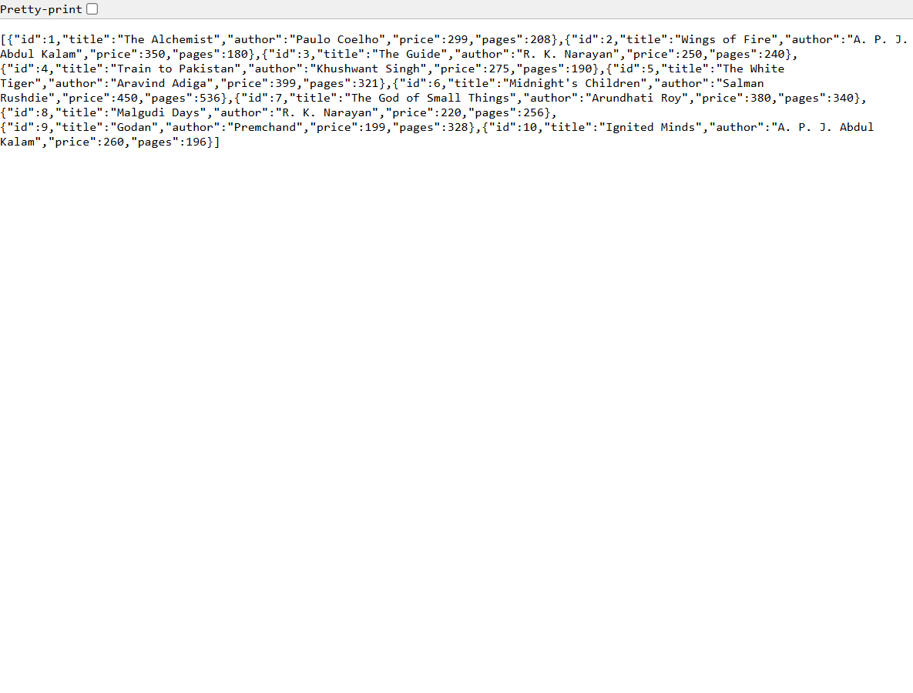
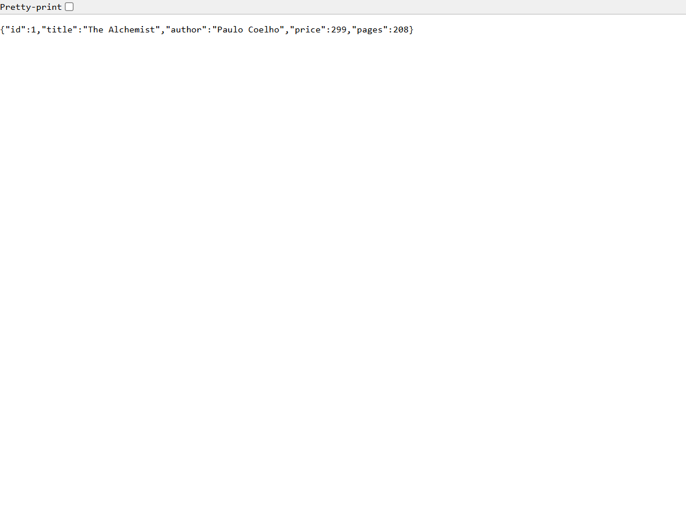
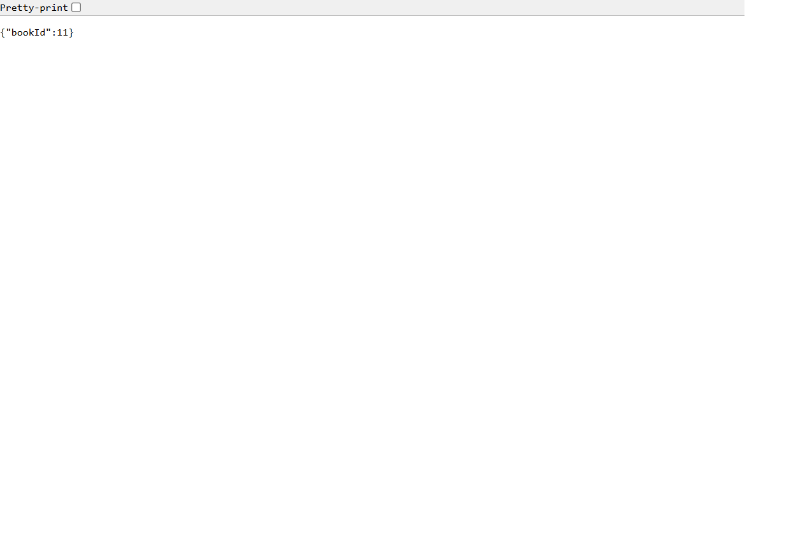
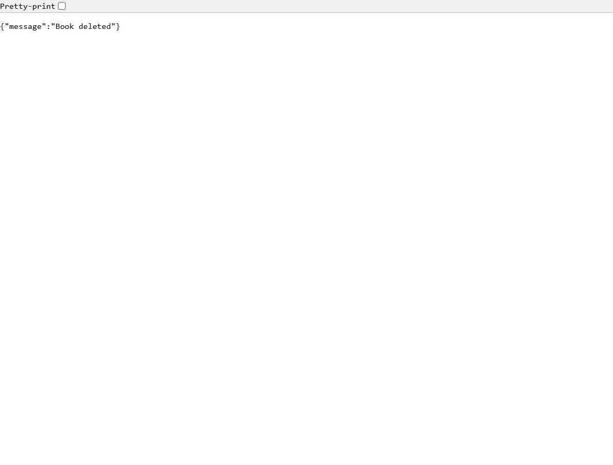
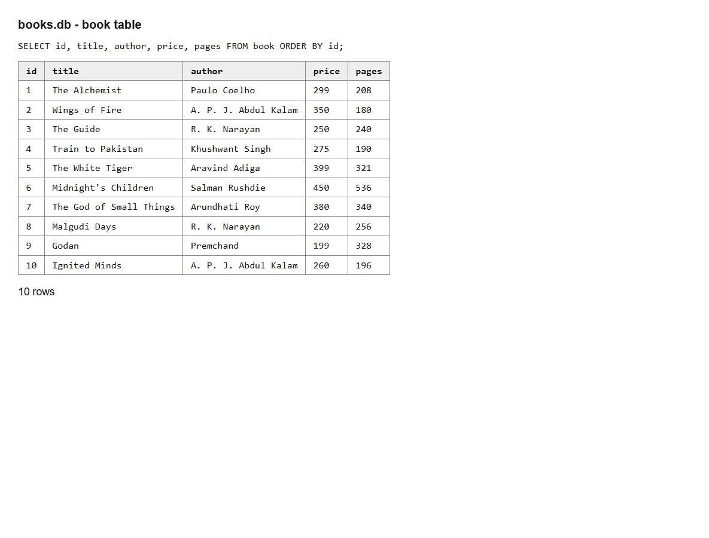

# Lab 2: SQLite database and CRUD routes

**Name:** <paremishetti srisairam> · **Registration number:** <252U1R9119> · **Section:** <GEN-A-111(2B)>

**Live link:** <https://lab-2-backend-7org.onrender.com>

## How to run

```bash
npm install
npm run dev      # nodemon, restarts on every change
# or
npm start
```

Environment variables (see `.env.example`; never commit the real `.env`):

| Variable | Description |
| --- | --- |
| `PORT` | Port for the server (default 3000) |

The database file is `books.db`. To recreate it: `sqlite3 books.db < schema.sql`

## Endpoints

| Method | Path | Description |
| --- | --- | --- |
| GET | `/books/` | Get all books |
| GET | `/books/:bookId/` | Get one book (404 if missing) |
| POST | `/books/` | Add a book (201, returns new id) |
| PUT | `/books/:bookId/` | Update a book (404 if missing) |
| DELETE | `/books/:bookId/` | Delete a book (404 if missing) |

Body for POST/PUT: `{ "title": "", "author": "", "price": 0, "pages": 0 }`

## Screenshots

The API responses are shown in the browser's raw JSON view. The database view shows the current rows in `books.db`.








## Notes

Problems faced and how I solved them: <write here>

## Viva notes

- **Why await the database call?** DB calls are asynchronous and return Promises; without `await` the handler would respond before the data arrives.
- **SQL injection and placeholders:** injection is when user input is joined into the SQL string and runs as code. `?` placeholders send the value separately from the query, so it is always treated as data.
- **PUT vs POST:** POST creates a new resource (server assigns the id); PUT replaces/updates an existing resource at a known URL and is idempotent.
